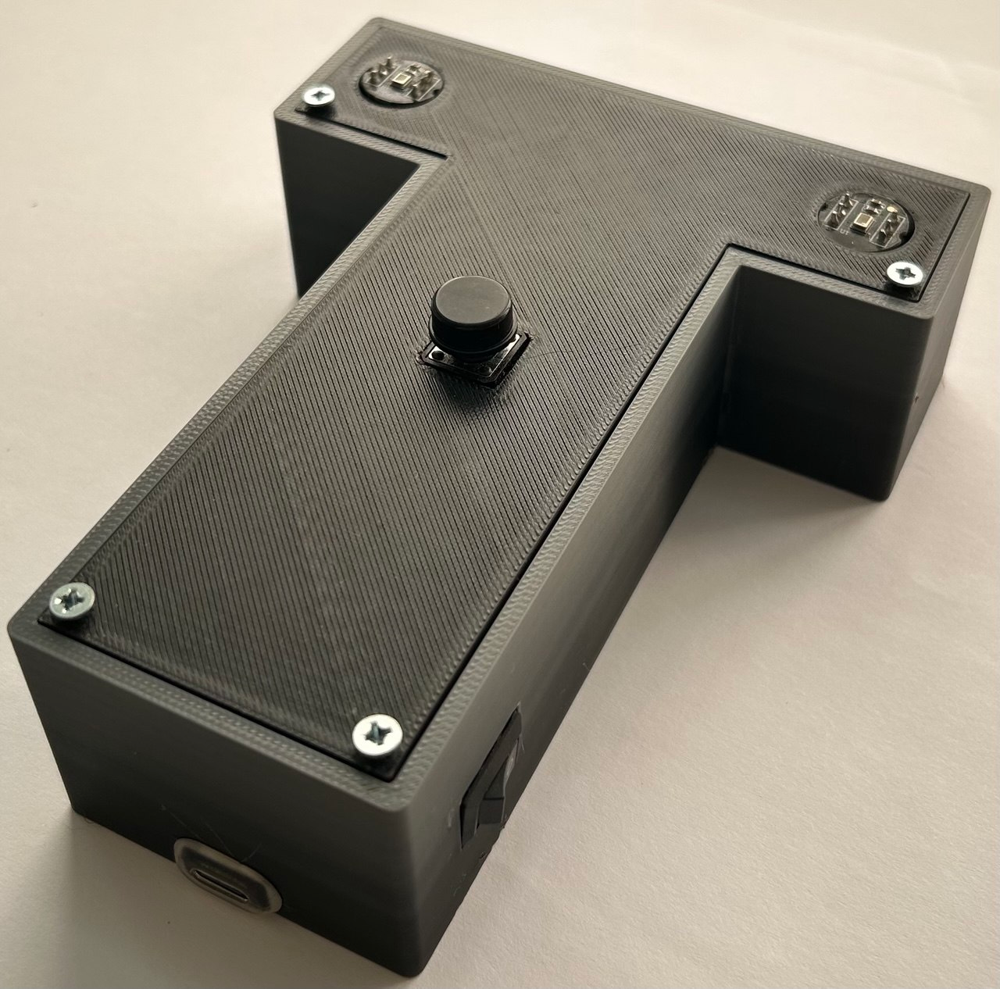
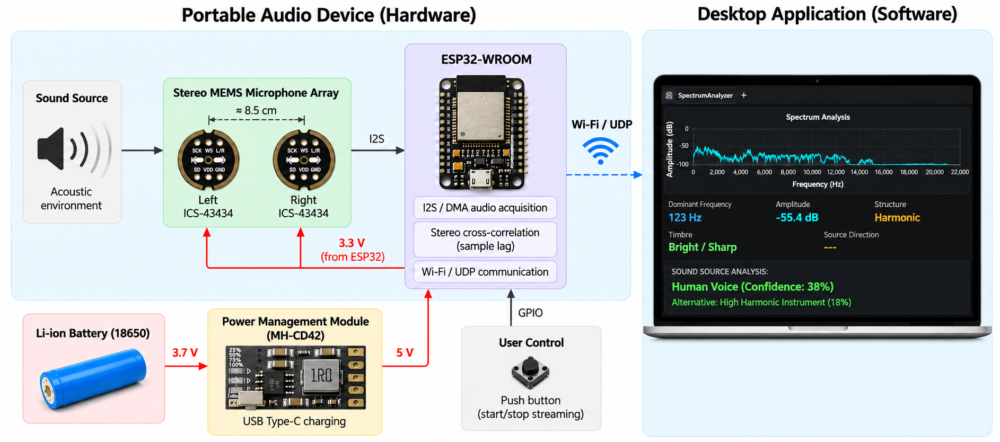
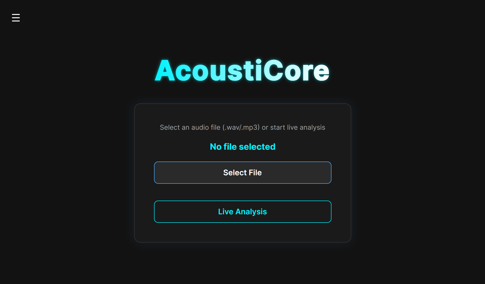
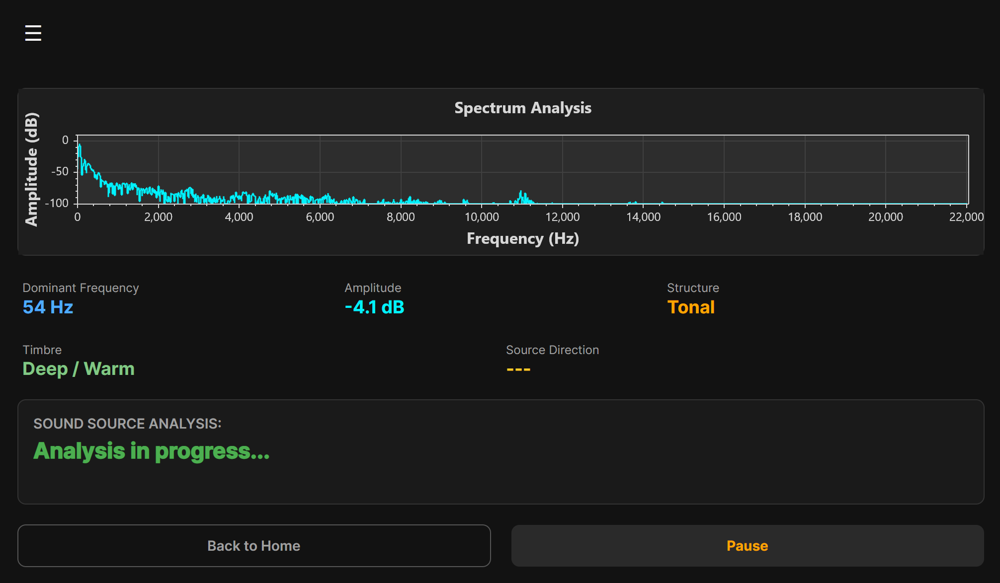

# AcoustiCore

**A Hardware and Software System for Real-Time Audio Analysis and Sound Source Classification**

AcoustiCore is a portable audio analysis system developed as a Bachelor's thesis project in Computer Engineering. It combines a custom-built ESP32 stereo microphone device with a C#/.NET desktop application for real-time audio acquisition, spectral analysis, sound-source classification, and sound-direction estimation.

The system supports both live audio streamed over Wi-Fi and offline analysis of WAV/MP3 files.

## Demo

A demonstration of the physical prototype and desktop application, including file-based analysis, live audio streaming, frequency detection, and sound-direction estimation.

**[▶ Watch the AcoustiCore System Demonstration](https://youtube.com/shorts/kA3IAlAkW74)**

## System Architecture

The portable device captures stereo audio using two ICS-43434 digital MEMS microphones connected to an ESP32 through I2S. The ESP32 processes the incoming samples, estimates the inter-channel delay using cross-correlation, and transmits stereo audio and delay information to a desktop computer over Wi-Fi/UDP.

The desktop application receives the audio stream, performs spectral analysis, extracts signal features, and displays the results through an interactive graphical interface.

## Features and Signal Processing

- **Two analysis modes:** live audio acquisition from the ESP32 device and WAV/MP3 file analysis.
- **Spectral analysis:** 4096-point Fast Fourier Transform (FFT) with Hann windowing.
- **Audio characteristics:** dominant frequency, spectral centroid, peak spectral level, structure, and timbre descriptors.
- **Sound-source classification:** heuristic, rule-based classification using extracted spectral features.
- **Sound-direction estimation:** stereo cross-correlation for inter-channel delay estimation, presented as Left, Center, or Right.
- **Real-time visualization:** live frequency spectrum and analysis results in the desktop application.

The sound-source classifier uses predefined signal-processing rules rather than a trained machine-learning model. Direction estimation provides a coarse three-category indication, not a precise angular measurement.

## Desktop Application

The application was developed in **C# with .NET 8 and Avalonia UI**. It uses FftSharp for Fourier transforms, NAudio for file playback and processing, and ScottPlot for spectrum visualization.

**Home Screen**

Select an audio file or start live analysis using the ESP32 device.

**Analysis Interface**

Visualize the frequency spectrum, signal characteristics, and sound-source analysis results.

## Hardware

The portable prototype consists of:

- ESP32-WROOM microcontroller
- Two ICS-43434 digital MEMS microphones, spaced approximately 8.5 cm apart
- I2S stereo audio acquisition at 44.1 kHz
- Wi-Fi/UDP data transmission
- Rechargeable 18650 battery and charging/power module
- Push button for controlling audio streaming
- Custom 3D-printed enclosure designed in Autodesk Fusion

The device was assembled and soldered on perfboard, integrated into the enclosure, and tested with the desktop application.

**[Hardware documentation, schematic, CAD models, and prototype photos](hardware/README.md)**

## Technologies

| Area | Technologies |
| --- | --- |
| Embedded development | ESP32, C/C++, I2S, DMA, Wi-Fi, UDP |
| Desktop development | C#, .NET 8, Avalonia UI |
| Audio processing | FFT, Hann window, spectral features, cross-correlation |
| Software libraries | FftSharp, NAudio, ScottPlot |
| Electronics and design | Proteus, Autodesk Fusion, 3D printing |

## Repository Structure

- `desktop-app/` — C#/.NET desktop application and interface screenshots
- `firmware/esp32/` — ESP32 firmware and example network configuration
- `hardware/` — electronics, schematic, enclosure models, and prototype photos
- `docs/` — system architecture diagram

## Getting Started

### Desktop Application

1. Install the .NET 8 SDK.
2. Open `desktop-app/SpectrumAnalyzer.sln` in Visual Studio or another compatible .NET development environment.
3. Restore the project dependencies and build the application.
4. Run the application and select an audio file for offline analysis.

### ESP32 Firmware

1. Install Arduino IDE with ESP32 board support.
2. Open `firmware/esp32/SpectrumAnalyzerFirmware/SpectrumAnalyzerFirmware.ino`.
3. Copy `config.example.h` to `config.h` in the same directory.
4. Set the Wi-Fi credentials and the desktop computer's local IP address in `config.h`.
5. Upload the firmware to the ESP32.

For live operation, connect the ESP32 and desktop computer to the same local network. The desktop application listens for UDP audio packets on **port 5555**. Press the device button to start or stop streaming.

Live analysis requires the stereo microphone hardware described in the hardware documentation.

---

*Developed as a Bachelor's thesis project in Computer Engineering (2025–2026) at Yuriy Fedkovych Chernivtsi National University, Ukraine.*