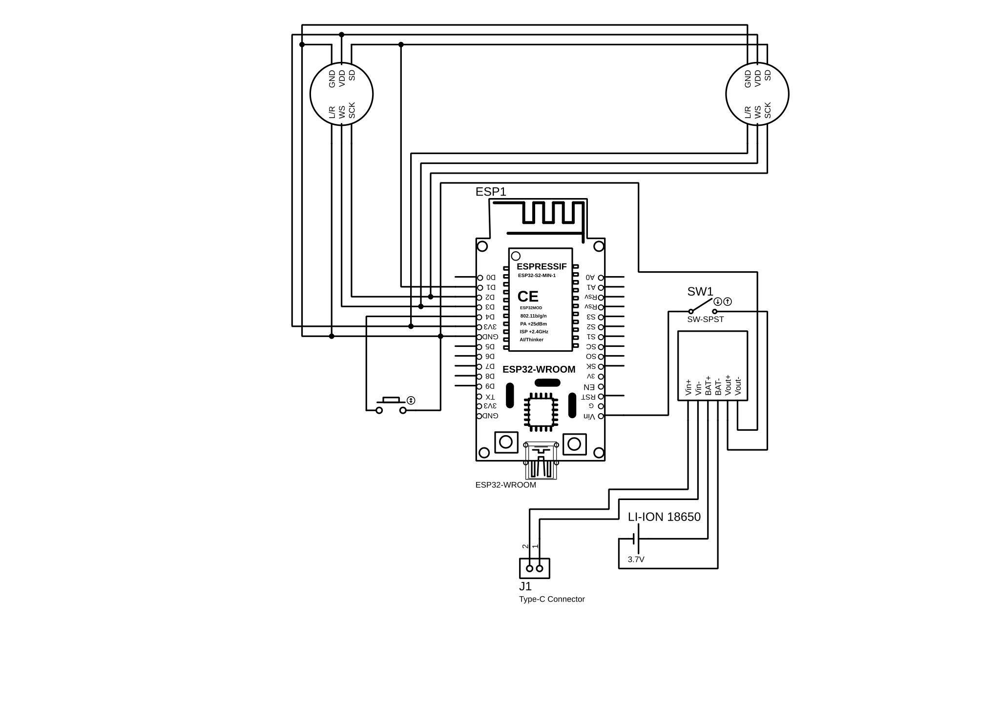
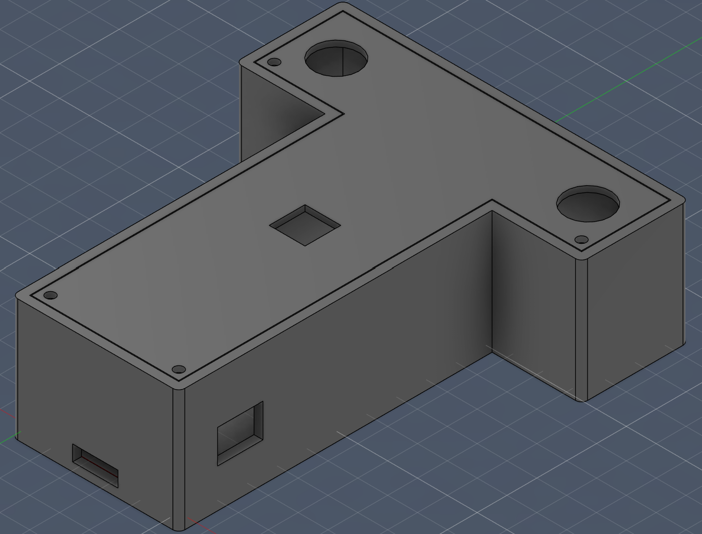
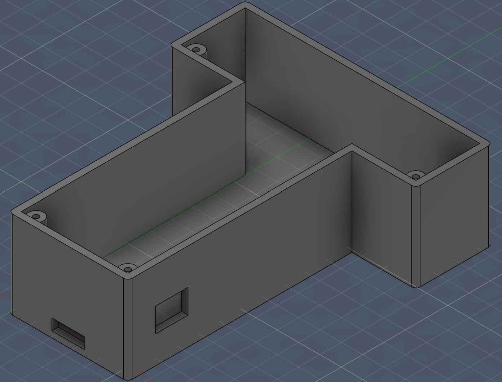
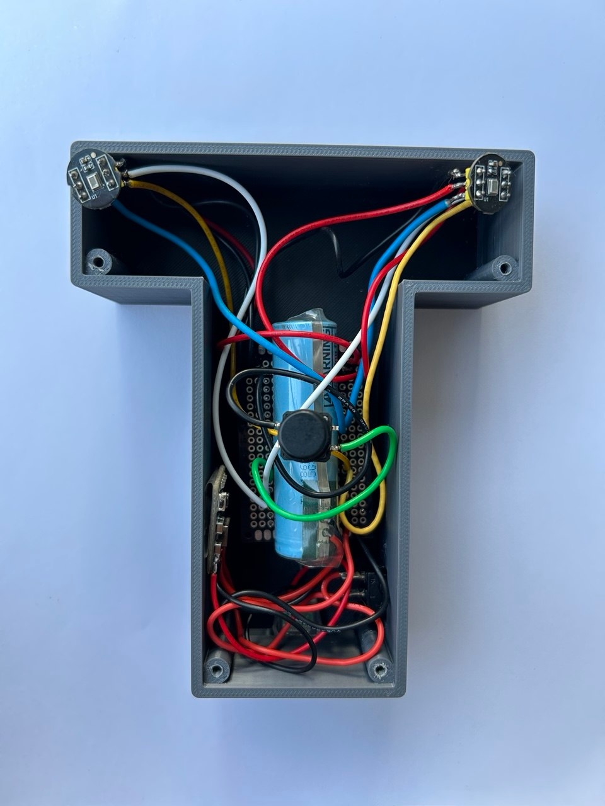

# Hardware

## Overview

The hardware is a portable stereo audio acquisition module built around an ESP32 and two ICS-43434 digital MEMS microphones. It captures synchronized audio at 44.1 kHz through I2S/DMA, estimates the inter-channel sample lag using cross-correlation, and streams stereo audio together with the calculated lag to the desktop application over Wi-Fi/UDP.

The complete prototype was designed, assembled, soldered, and tested as part of the project.

## Electronics

The two microphones form a fixed stereo pair with approximately 8.5 cm spacing. They share the ESP32 I2S interface and are configured as left and right channels for synchronized acquisition and direction estimation.

| Signal | ESP32 GPIO |
| ------ | ---------- |
| I2S BCLK | GPIO 14 |
| I2S WS / LRCLK | GPIO 15 |
| I2S DATA | GPIO 32 |
| Push button | GPIO 4 |

The editable Proteus project is available in [`electronics/proteus/`](electronics/proteus/).

## Enclosure

The T-shaped enclosure was designed in Autodesk Fusion to maintain the microphone spacing and accommodate the electronics, battery, controls, and charging connection. The final enclosure was manufactured using 3D printing.

The [`enclosure/`](enclosure/) directory contains the original Fusion design, STEP export, and 3MF files used for 3D printing.

## Prototype

The electronics were manually assembled and soldered on perfboard and integrated into the custom enclosure. The completed device was used for real-time audio acquisition, wireless streaming, and sound-direction testing with the desktop application.

